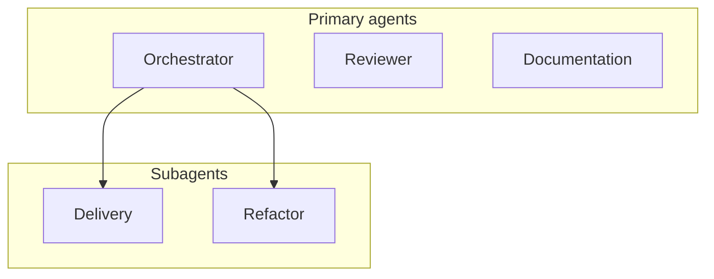

# Subagents

A single agent that explores, plans, codes, and reviews in one context gets saturated: it forgets the essentials, drifts, and costs more tokens. The plugin splits the work between agents with a narrow role and only the context they need.

## Roles

| Agent | Mode | Can | Cannot |
| --- | --- | --- | --- |
| **Orchestrator** | primary | Clarify, plan features, delegate, archive, maintain `memory.md`, suggest commits. | Write specs, production code, tests, or reviews. |
| **Delivery** | subagent | Write `spec.md`, ask for approval, implement and test the approved plan. | Code before approval; change `memory.md`; commit. |
| **Refactor** | subagent | Verify every `AC-*`/`EC-*`, apply rule checks, fix directly related issues. | Change approved behavior; make speculative or unrelated changes; commit. |
| **Reviewer** | primary | Review changes with Open Code Review, propose a fix plan, apply fixes after approval. | Stage or commit. |
| **Documentation** | primary | Discover, create, update, and audit technical docs. | Write before approval; modify application code. |

The orchestrator calls Delivery **once per feature**, then always calls Refactor once implementation has started — even if Delivery reported gaps.

## Isolation in practice

- The orchestrator passes Delivery only the relevant requirements and workspace facts.
- Delivery inspects only nearby code needed to make decisions, and loads only the rules returned by `rules_for`.
- Refactor works from the approved spec and the repository state, not from Delivery's conversation.
- The reviewer is the only agent that runs `ocr`; other agents point review requests to `/review`.

See the [agents reference](../reference/agents) for details.
