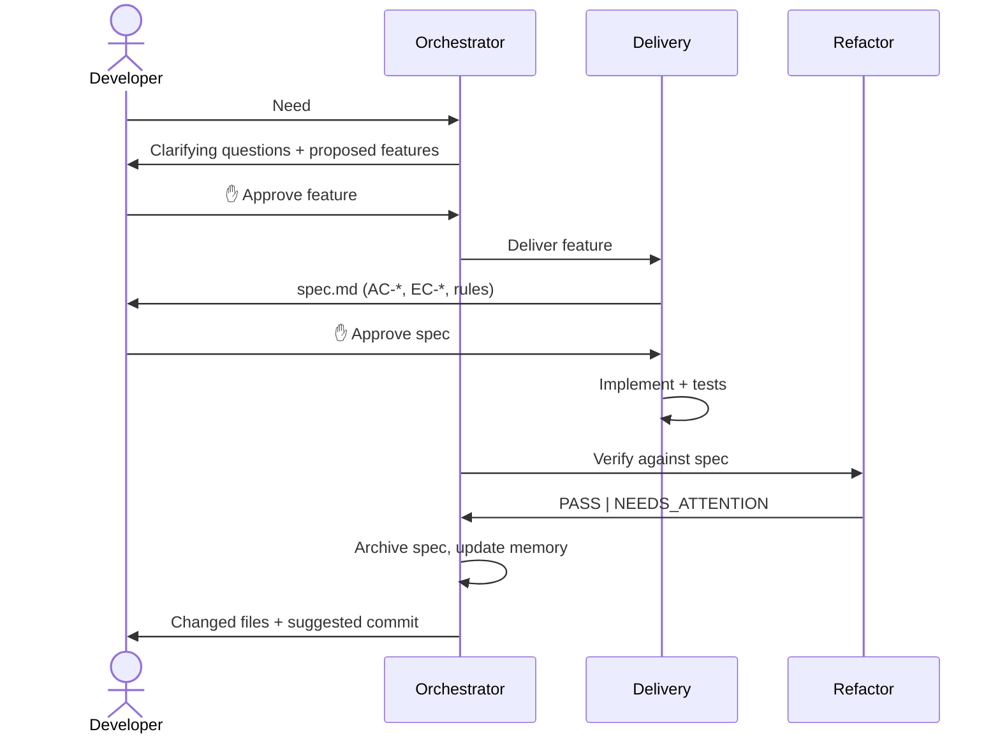

# Workflow

The workflow turns a request into small, approved features, then delegates bounded work with explicit approval and verification points.

## Steps

1. **Orchestrator** clarifies requirements, proposes small features, and waits for your approval before starting each one.
2. **Delivery** writes a decision-complete spec with acceptance and edge-case criteria, asks for explicit approval, then implements and tests only the approved plan.
3. **Refactor** checks the implementation against the approved criteria and the engineering rules, fixes directly related issues, and reports any remaining gaps.
4. **Orchestrator** archives the spec, lists the feature's changed files, and strongly recommends that you review and commit them, with a suggested [Karma-style](http://karma-runner.github.io/latest/dev/git-commit-msg.html) message.

## Approval gates

| Gate | Who asks | What unlocks it |
| --- | --- | --- |
| Feature approval | Orchestrator | Your approval of the proposed feature. |
| Spec approval | Delivery | An explicit `Approve` answer. Feature approval, silence, or ambiguous feedback do not count. |

On `Request changes`, Delivery revises only the spec and asks again.

## Statuses

| Scope | Values |
| --- | --- |
| Project | `PLANNING`, `IN PROGRESS`, `COMPLETE`, `NEEDS_ATTENTION` |
| Feature | `PENDING`, `IN PROGRESS`, `DONE`, `NEEDS_ATTENTION` |
| Delivery / Refactor | `-`, `PASS`, `NEEDS_ATTENTION` |

`NEEDS_ATTENTION` records a gap or divergence — an uncovered criterion, a failed check, missing test infrastructure. It is **informational, not a flow-control status**: once implementation has started, it does not skip Refactor or archiving. You see every gap in the memory and the final report.

A feature is `DONE` when Delivery and Refactor both report `PASS`.

## When the workflow pauses

- An approval is missing.
- Uncommitted changes remain before a new feature, so you can commit them first. If you choose to continue, the pre-existing changed paths are passed to Refactor so they are not attributed to the feature.

## Why no automatic commit?

Committing is the moment you take ownership of the change. The agents prepare everything — changed files, verified criteria, a suggested message — but no agent stages, commits, amends, pushes, or publishes.
