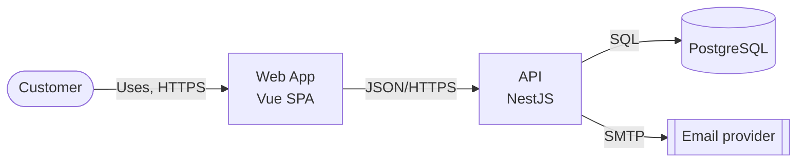

# C4 Architecture Documentation

Load `docs-conventions` first. Output goes to `docs/architecture/`.

## Levels

| Level | Question answered | Reader | File |
| --- | --- | --- | --- |
| Context | Who uses the system and which external systems does it depend on? | Everyone | `context.md` |
| Containers | Which applications, services, and data stores make up the system, and how do they communicate? | Developers, ops, leads | `containers.md` |
| Components | How is one container broken down internally? | Developers of that container | `components-<container>.md` |
| Code | Classes and interfaces | Rarely needed; use `docs-class` | — |

A "container" is a runnable unit or a data store (API, SPA, worker, database, queue), not necessarily a Docker container. Context and Containers are usually enough; add Components only for complex containers.

## Workflow

1. **Ask** which level(s) and which reader. Default to Context then Containers.
2. **Gather evidence** from the repository:
   - Entry points, `package.json`/build files, `docker-compose`, Helm/Kubernetes, infrastructure code, CI deployment files.
   - Environment variables and configuration naming external services (URLs, queues, buckets, SSO).
   - HTTP clients, message producers/consumers, database connections.
   - For components: modules/packages and their imports.
3. **Ask the user** for what code cannot show: people/roles, owners, protocols, sync vs async, systems outside the repository.
4. **Choose** Mermaid or Archify (Archify type `architecture`) using `docs-conventions`.
5. **Draft**, show it, adjust, then write and update `docs/README.md`.

## Template

````markdown
# <System> — <Context | Containers | Components of X>

**Scope:** <what is shown and what is not>. **Reader:** <who>. **Last verified:** <YYYY-MM-DD>.

<Two or three sentences describing the view.>



## Elements

| Element | Kind | Responsibility | Technology |
| --- | --- | --- | --- |
| <name> | Person / Container / External system | <responsibility> | <tech> |

## Interactions

- <Source> → <Target>: <purpose>, <protocol>, <sync/async>.

## Notes

- <Constraints, risks, open questions.>
````

Mermaid's native `C4Context` / `C4Container` syntax may be used when the renderer in use supports it; `flowchart` is the portable default.

## Quality Checklist

- Each element has a name, kind, responsibility, and technology.
- Each arrow has a label describing intent and protocol.
- The diagram has a title, scope, and legend when shapes carry meaning.
- External systems are visually distinct from internal ones.
- Nothing appears that is not backed by code, configuration, or user input.
