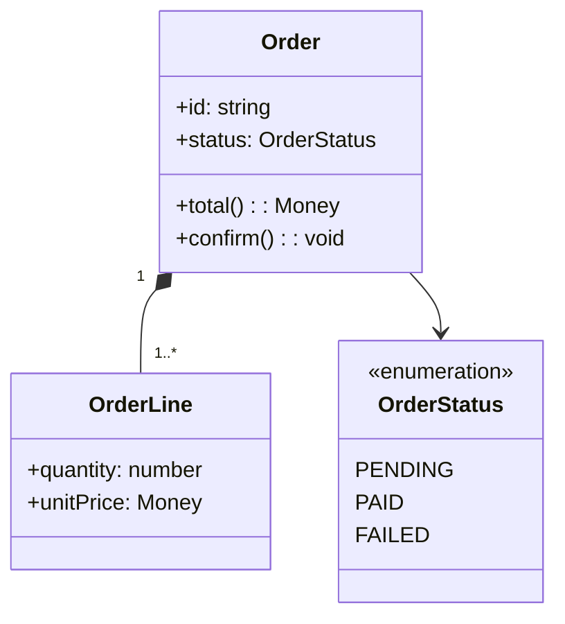

# Class Diagrams

Load `docs-conventions` first. Output goes to `docs/design/<model>.md`.

A class diagram describes classes, their attributes and operations, and the relations between them. Limit it to the scope useful to the reader: a domain, an aggregate, or a module. Never dump every class.

## Workflow

1. **Ask** which model or module, which reader, and which question it answers (responsibilities, relations, extension points).
2. **Extract from code**: classes, interfaces, enums, public attributes and operations, `extends`/`implements`, fields typed as other classes, collections (multiplicity), constructor injection (dependency).
3. **Filter**: keep the elements and members that matter to the question; omit getters/setters, framework boilerplate, and private helpers.
4. **Choose** Mermaid (`classDiagram`) or Archify (type `class`) using `docs-conventions`. Prefer Archify above about 12 classes.
5. **Draft**, show it, adjust, then write and update `docs/README.md`.

## Relations

| Relation | Mermaid | Meaning |
| --- | --- | --- |
| Inheritance | `A <\|-- B` | B is an A |
| Realization | `I <\|.. C` | C implements I |
| Composition | `A *-- B` | B's lifecycle is owned by A |
| Aggregation | `A o-- B` | A groups B, which can exist alone |
| Association | `A --> B` | A holds a reference to B |
| Dependency | `A ..> B` | A uses B transiently |

Add multiplicities (`"1" --> "*"`) when they carry business meaning.

## Template

````markdown
# <Model name>

**Scope:** <domain or module>. **Reader:** <who>. **Last verified:** <YYYY-MM-DD>.



## Responsibilities

| Class | Responsibility | Code |
| --- | --- | --- |
| <Class> | <one sentence> | `path/to/file.ts` |

## Notes

- <Invariants, design choices, links to ADRs.>
````

## Quality Checklist

- Each class has a clear single responsibility described in the table.
- Relations use the right kind (composition vs association vs dependency).
- Only members relevant to the question are shown.
- Stereotypes mark interfaces, enums, abstract classes.
- Every class exists in the code under the same name.
