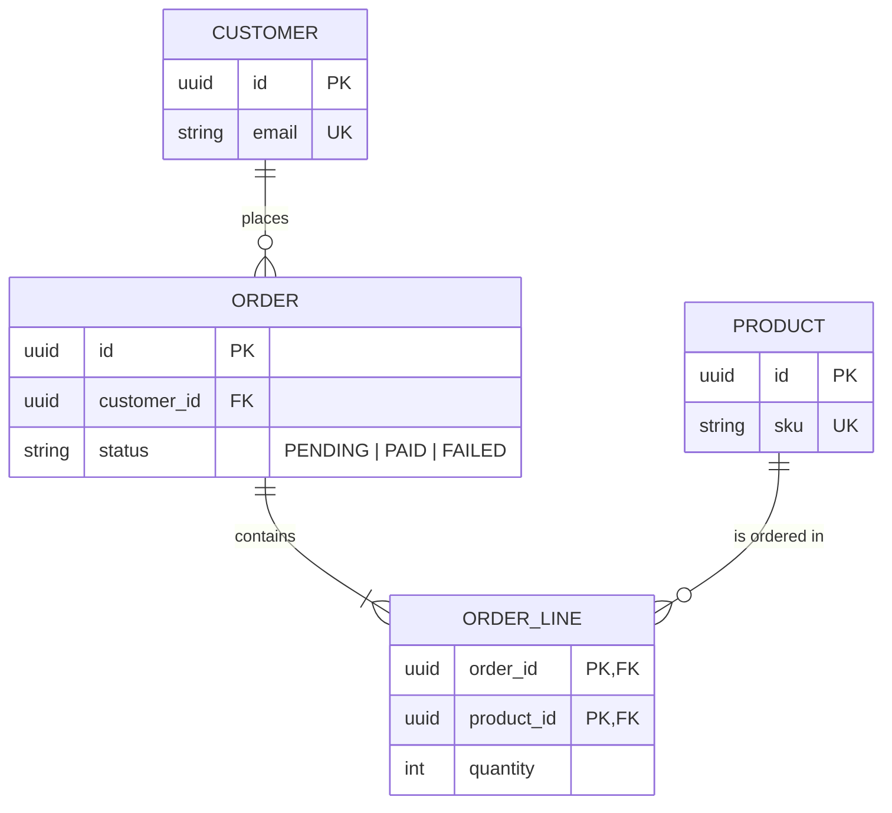

# Database Diagrams (ERD)

Load `docs-conventions` first. Output goes to `docs/data/<domain>.md`.

The ERD must match the **deployed schema**. Prefer one diagram per functional domain over one huge diagram.

## Workflow

1. **Locate the schema source of truth**: `schema.prisma`, migration folders, SQL DDL, ORM entities (TypeORM, Sequelize, JPA, Doctrine...), or a database dump provided by the user.
2. **Ask** which domain(s) and which reader. If the schema is large, propose a split by domain and confirm it.
3. **Extract**: tables, primary keys, foreign keys, unique constraints, nullable columns, enums, indexes that carry meaning, cascade rules.
4. **Filter columns**: keep keys, business-significant columns, and constraints; summarize technical columns (`created_at`, `updated_at`) in a note.
5. **Choose** Mermaid (`erDiagram`) or Archify (type `erd`) using `docs-conventions`. Prefer Archify above about 12 tables.
6. **Draft**, show it, adjust, then write and update `docs/README.md`.

## Cardinality (Mermaid)

| Notation | Meaning |
| --- | --- |
| `\|\|--\|\|` | exactly one to exactly one |
| `\|\|--o{` | one to zero or more |
| `\|\|--\|{` | one to one or more |
| `}o--o{` | many to many (show the join table instead when it exists) |

## Template

````markdown
# Data model — <Domain>

**Scope:** <tables included>. **Source:** `<path to schema or migrations>`. **Reader:** <who>. **Last verified:** <YYYY-MM-DD>.



## Tables

| Table | Purpose | Key constraints |
| --- | --- | --- |
| <table> | <business meaning> | <PK, UK, FK on delete ...> |

## Conventions

- <Naming, soft delete, timestamps, tenancy columns.>

## Related

- Other domains: [<domain>](./<domain>.md)
````

## Quality Checklist

- Every table and column exists in the schema source with the same name.
- Relations carry correct cardinality and a verb label.
- Cross-domain relations point to the other domain's diagram.
- Constraints that protect business rules (unique, check, cascade) are listed.
- The source path and verification date are stated.
