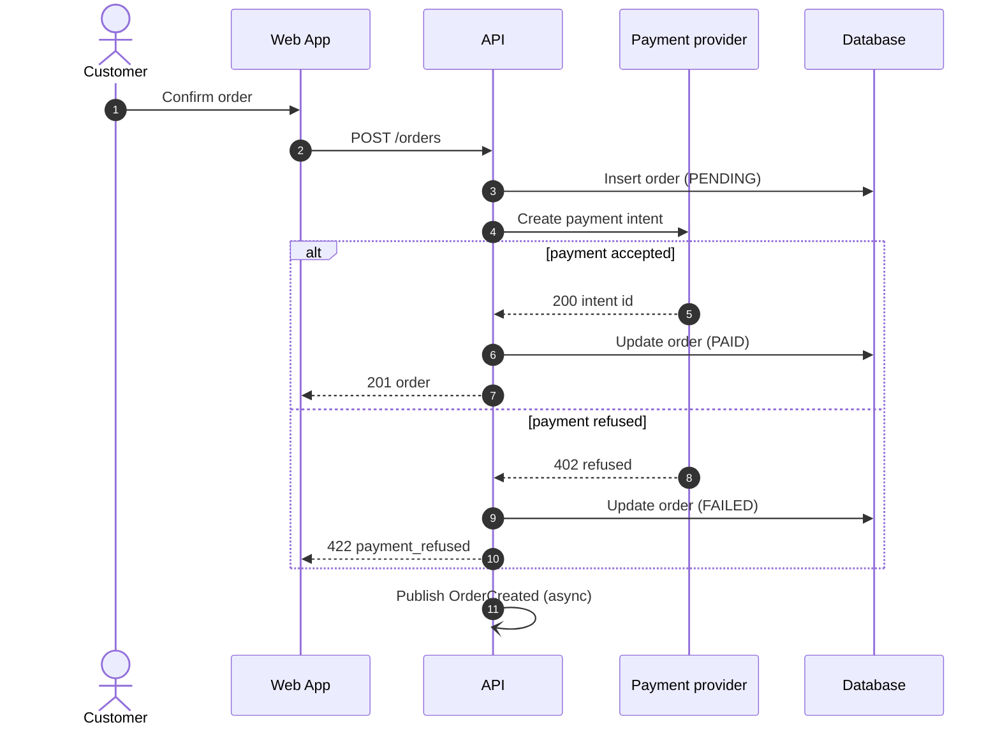

# Sequence Diagrams

Load `docs-conventions` first. Output goes to `docs/flows/<scenario>.md`.

A sequence diagram shows the participants of **one scenario** and their interactions in chronological order. Document critical or non-obvious scenarios only.

## Workflow

1. **Ask** which scenario, its trigger, its expected outcome, and the reader. One scenario per diagram; split long flows.
2. **Trace the code** from the entry point (route, controller, handler, consumer, UI action) through services, repositories, HTTP clients, and message producers. Record each call, its payload, and its response.
3. **Ask the user** for what code cannot show: external systems' behavior, timeouts, retries, SLAs, business rules behind branches.
4. **Include** the main path, then significant alternatives (`alt`), optional steps (`opt`), loops, and error handling. Mark async calls distinctly.
5. **Choose** Mermaid (`sequenceDiagram`) or Archify (type `sequence`) using `docs-conventions`. Prefer Archify for more than about 6 participants or 20 messages.
6. **Draft**, show it, adjust, then write and update `docs/README.md`.

## Template

````markdown
# <Scenario name>

**Trigger:** <what starts it>. **Outcome:** <expected result>. **Reader:** <who>. **Last verified:** <YYYY-MM-DD>.



## Steps

1. <Step number>: <what happens and why; code location `path/to/file.ts`>.

## Errors and Edge Cases

- <Failure>: <handling, retry, compensation>.
````

## Quality Checklist

- Participants are named after real components; actors are distinguished.
- Messages describe intent and protocol (`POST /orders`, `publish OrderCreated`).
- Responses and error branches are shown, not only the happy path.
- Async messages use a distinct arrow (`-)`).
- Steps reference code locations so the diagram can be checked.
