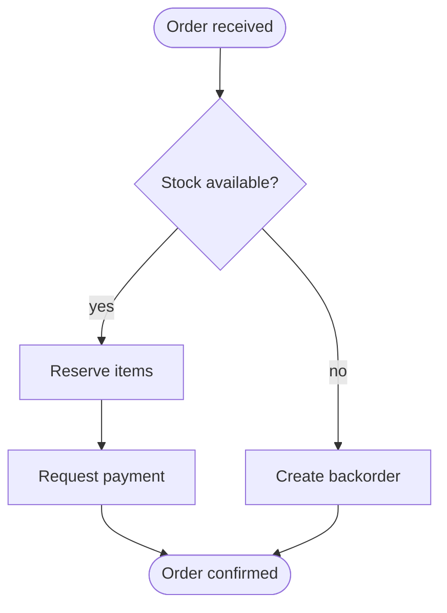
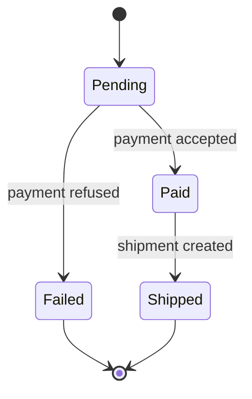
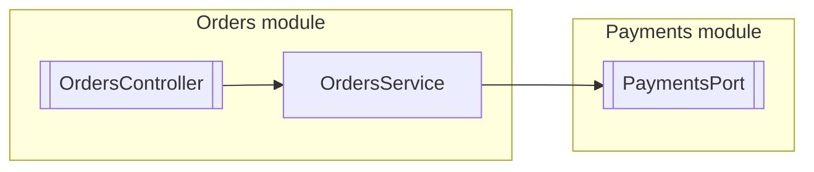
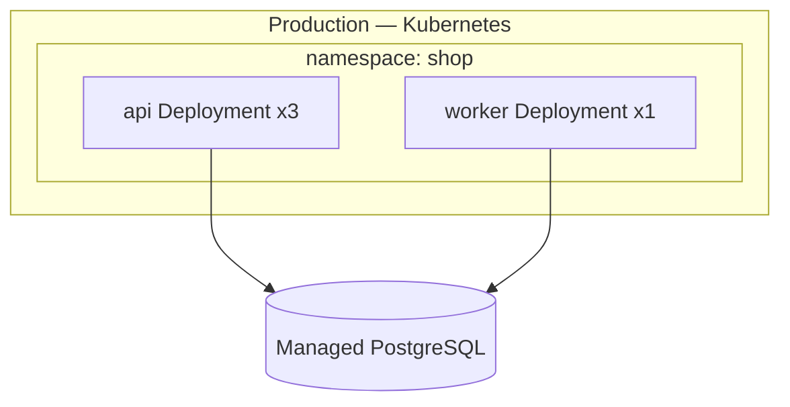

# UML Views

Load `docs-conventions` first. For sequence diagrams use `docs-sequence`; for class diagrams use `docs-class`; for system-level architecture use `docs-c4`.

## Choose the View

| View | Question | Mermaid | Archify type | Folder |
| --- | --- | --- | --- | --- |
| Component | What are the modules, their interfaces and dependencies? | `flowchart` | `architecture` | `docs/design/` |
| Activity | What are the steps, conditions, and branches of a process? | `flowchart` | `workflow` | `docs/flows/` |
| State | Which states can an entity take, and which events move it? | `stateDiagram-v2` | `lifecycle` | `docs/design/` |
| Deployment | Where does each software element run in each environment? | `flowchart` with subgraphs | `architecture` | `docs/architecture/` |

## Workflow

1. **Ask** which question the reader needs answered, then pick the view from the table.
2. **Extract from code**:
   - Component: module/package boundaries, exported interfaces, imports between modules.
   - Activity: the orchestrating function or job, its branches, validations, and error exits.
   - State: status enums, transition methods, guards, database status columns.
   - Deployment: Dockerfiles, compose, Kubernetes/Helm, infrastructure code, CI deploy jobs, environment configs.
3. **Ask the user** for business meaning of branches and states, and for infrastructure not in the repository.
4. **Choose** Mermaid or Archify using `docs-conventions`.
5. **Draft**, show it, adjust, then write and update `docs/README.md`.

## Templates

Every document starts with:

```markdown
# <Title>

**Scope:** <...>. **Reader:** <...>. **Last verified:** <YYYY-MM-DD>.

<Two or three sentences describing the view.>
```

### Activity



### State



Follow the state diagram with a transition table: `From | Event | Guard | To | Code`.

### Component



### Deployment



Follow the deployment diagram with a table: `Element | Environment | Runtime | Scaling | Config source`.

## Quality Checklist

- One view answers one question; do not mix views in one diagram.
- Activity: every decision has labelled outcomes; start and end are explicit.
- State: every state is reachable; terminal states are marked; transitions name their event.
- Component: dependencies point in the allowed direction; cycles are flagged.
- Deployment: one diagram per environment when they differ.
